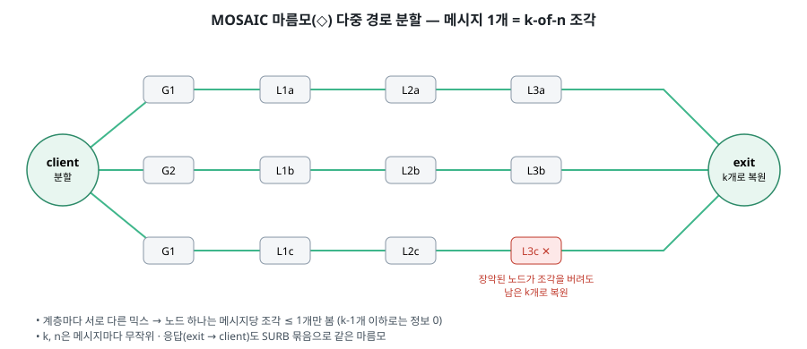

# MOSAIC

**M**ix-network **O**verlay with **S**phinx, **A**nonymous **I**nternet access and **C**over traffic

MOSAIC은 인터넷용 익명 통신 시스템과 이를 쓰는 브라우저를 함께 담은 연구용 프로토타입이다.
네트워크 운영자, 통신사, 수동 감시자, 악성 중계 노드, 그리고 망 전체를 관찰할 수 있는 국가급
공격자까지 상정하고 설계했다. 목표는 두 가지다. 통신 내용을 숨기는 것, 그리고 **누가 누구와
통신하는지(관계 메타데이터)** 를 추적하기 어렵게 만드는 것이다.

> ⚠️ 아직 연구용 프로토타입이다. 독립적인 보안 감사를 받지 않았다. 생명이나 신변이 걸린
> 상황에서는 Tor Browser 같은 검증된 도구를 써야 한다. 한계는 [docs/THREAT_MODEL.md](docs/THREAT_MODEL.md)에 정리했다.

## 왜 Tor와 다른가

Tor 같은 저지연 onion routing은 패킷을 바로바로 중계한다. 그래서 망의 입구와 출구를 동시에
보는 공격자는 패킷의 타이밍과 양을 맞춰 보는 것만으로 송신자와 수신자를 연결할 수 있다.
MOSAIC은 이 **트래픽 상관(correlation) 공격**을 겨냥해 믹스넷 계열 기법(Loopix, Nym, Katzenpost)을 조합했다.

| 계층 | 기법 | 막는 것 |
|---|---|---|
| 분할 | **마름모(◇) 다중 경로**: 메시지마다 k-of-n 분할(SSMS), 서로 겹치지 않는 경로, 게이트웨이 여러 곳 | 노드 하나를 장악해 흐름 전체를 보거나 막는 것. 조각은 노드당 최대 1개이고, n-k개를 잃어도 복원된다 |
| 패킷 | **Sphinx** 고정 길이 패킷, 홉마다 블라인딩, LIONESS 페이로드 | 크기·비트 패턴으로 패킷 추적, 변조(tagging) 공격, 재전송 |
| 믹싱 | **연속 시간 Poisson 믹싱** (홉마다 지수분포 지연, 송신자가 결정) | 노드 입출력 타이밍 상관 |
| 커버 | 클라이언트 **λ_P / λ_L / λ_D** 세 가지 Poisson 흐름, 노드 루프, 게이트웨이 하향 더미 | "언제·얼마나 통신하는가" 노출, (n-1) 공격 |
| 링크 | **X25519 + ML-KEM-768 하이브리드** 핸드셰이크, 고정 길이 AEAD 프레임 | 지금 녹화해 두고 양자컴퓨터로 나중에 해독하기, 링크 내용 관찰 |
| 응답 | **SURB** (단일 사용 응답 블록) | 출구·서버가 응답을 돌려보내면서 클라이언트 위치를 알아내기 |
| 디렉터리 | **다중 권한 서버, k-of-n** 기술자 투표, 결정적 계층 배정 | 가짜 노드 주입, 클라이언트별로 다른 목록 보여주기(분할 공격), 노드가 원하는 위치 고르기 |
| 출구 | **`.mosaic` 네이티브 서비스**: 출구 없음, 종단 간 X25519+ML-KEM, 자기 인증 주소. 일반 인터넷은 **HTTPS 전용** | 출구 노드 장악. 서비스에는 출구가 없고, 일반 인터넷은 출구가 내용을 볼 수 없다 |
| 브라우저 | **스크립트 실행 안 함** + 강제 CSP, 사이트별 출구·쿠키 격리, 통일된 헤더, HTTPS 우선 | JS 지문채취, WebRTC IP 누출, 사이트 간 추적, DNS 누출 |

## 구조: 마름모(◇) 다중 경로



```
                       ┌─ G1 ─ L1a ─ L2a ─ L3a ─┐
 브라우저 ─▶ SOCKS5 ─▶ ◇ 클라이언트 ─┼─ G2 ─ L1b ─ L2b ─ L3b ─┼─ ◇ 출구 ─▶ 인터넷
     (k-of-n 분할)    └─ G1 ─ L1c ─ L2c ─ L3c ─┘   (k개 모이면 복원)

 응답:  출구 ◇─┬─ L1 ─ L2 ─ L3 ─ G1 ─┬─◇ 클라이언트   (SURB 묶음 = 경로가 서로 겹치지 않는 SURB n개)
              └─ L1'─ L2'─ L3'─ G2 ─┘
```

- 메시지(셀) 하나를 **k-of-n 조각**으로 나눈다. 메시지마다 새 키로 암호화하고, 암호문은 Rabin IDA로,
  키는 Shamir 비밀분산으로 나눈다. 조각 하나하나가 독립된 Sphinx 패킷이다.
- 조각들은 **계층마다 서로 다른 믹스**를 지나고, 게이트웨이도 여러 곳으로 나눠 쓴다. 출구에서 다시 모인다.
  선형 도면으로 그리면 **마름모** 모양이다.
- k와 n은 메시지마다 무작위로 고른다 (기본: k∈{2,3}, n=k+{1,2}). 응답 방향은 2-of-3이다.
- **게이트웨이**는 클라이언트 IP를 알지만 목적지는 모르고, 조각 일부만 본다.
- **믹스**는 바로 앞 홉과 다음 홉만 알고, 메시지당 조각을 최대 하나만 본다.
- **출구**는 목적지는 알지만 송신자는 모른다. SURB로만 답할 수 있다.
- 종단 간 TLS를 쓰면 출구도 내용을 볼 수 없다.

## 출구 노드 문제와 `.mosaic`

일반 인터넷 서버에 닿으려면 누군가는 마지막에 직접 연결해야 한다 (출구). 이것은 어떤 익명 시스템에서도
없앨 수 없다. MOSAIC은 이렇게 대응한다.

1. **출구를 없앤다.** `.mosaic` 서비스에서는 마름모의 오른쪽 꼭짓점이 목적지 자신이다.
   ```
   클라이언트 ◇─┬─ G ─ L1 ─ L2 ─ L3 ─ G_s1 ─┬─◇ 서비스   (E2E: X25519 + ML-KEM-768)
               └─ G'─ L1'─ L2'─ L3'─ G_s2 ─┘
   ```
   서비스 측 게이트웨이가 조각을 모두 모아도 암호문만 얻는다 (`tests/test_service.py`에서 검증).
   서비스는 클라이언트가 누구인지 모르고, 클라이언트는 서비스의 IP를 모른다.
2. **출구가 내용을 못 보게 한다.** 브라우저는 HTTPS 전용으로 동작하고, 다운그레이드 리다이렉트와 HTTP 하위 리소스를 차단한다.
3. **출구가 송신자를 못 찾게 한다.** Tor에서는 출구를 장악하고 입구를 관찰해 타이밍을 맞춰 보면 송신자를 특정할 수 있다.
   MOSAIC은 Poisson 믹싱, 커버 트래픽, 조각 분할로 이 상관을 끊는다. 또 사이트마다 출구가 다르다.

자세한 비교는 [위협 모델](docs/THREAT_MODEL.md#출구-노드를-장악하면-tor와-무엇이-다른가)에 정리했다.

```bash
# 로컬 웹서버(127.0.0.1:8080)를 .mosaic 서비스로 게시
mosaic serve --key svc.json --target 127.0.0.1:8080 $A
#  → [mosaic] 서비스 주소: http://<32자>.mosaic/
```
`mosaic testnet`을 실행하면 데모 `.mosaic` 서비스가 자동으로 함께 뜬다.

## 빠른 시작

```bash
pip install -e .            # Python 3.11+, cryptography>=47 (ML-KEM 지원)

# 로컬 테스트망 전체 + 클라이언트 + SOCKS5 + 브라우저
mosaic testnet
#  → [mosaic] SOCKS5 프록시: socks5h://127.0.0.1:9050
#  → [mosaic] 브라우저: http://127.0.0.1:8118/<token>/   ← 평소 쓰는 브라우저로 연다

# 다른 프로그램도 MOSAIC으로 보낼 수 있다
curl --socks5-hostname 127.0.0.1:9050 https://example.com

# 호환 모드: Chromium을 MOSAIC 전용 설정(DNS/WebRTC/QUIC 누출 차단, 기본 JS 끔)으로 실행
mosaic testnet --chromium
```

### 실제 분산 배치

```bash
# 1) 권한 서버 (3대 이상 권장, 서로 다른 운영 주체)
mosaic authority --key auth.key --listen 0.0.0.0:7000 --public-host dir1.example.org
#  → authority spec: dir1.example.org:7000:<pubkey>

A="--authority dir1.example.org:7000:<pk1> --authority dir2...:<pk2> --authority dir3...:<pk3> --threshold 2"

# 2) 노드
mosaic node --role gateway --key gw.json  --listen 0.0.0.0:7100 --public-host gw.example.org $A
mosaic node --role mix     --key mix.json --listen 0.0.0.0:7100 --public-host m1.example.org $A
mosaic node --role exit    --key ex.json  --listen 0.0.0.0:7100 --public-host x1.example.org $A

# 3) 클라이언트 + 브라우저
mosaic client $A --profile balanced
```

### 익명성 프로파일

| 프로파일 | 홉당 평균 지연 | λ_P (링크당) | 루프/드롭 | 게이트웨이 | 정방향 분할 | 응답 분할 | 용도 |
|---|---|---|---|---|---|---|---|
| `interactive` | 20 ms | 40/s | 2/s | 2 | k∈{2,3}, n=k+{1,2} | 2-of-3 | 웹 탐색 (기본값) |
| `balanced` | 100 ms | 25/s | 3/s | 2 | k∈{2,3}, n=k+{1,2} | 2-of-3 | 일반 |
| `paranoid` | 800 ms | 10/s | 4/s | 3 | k∈{3,4}, n=k+{2,3} | 3-of-5 | 메시징, 강한 공격자 상정 |

마름모 폭(n)만큼 계층마다 믹스가 있어야 조각이 노드를 공유하지 않는다. 테스트망 기본값은 계층당 4대다.

지연이 길고 커버 트래픽이 많을수록 전역 관찰자에 대한 익명성이 커진다. 대신 속도는 느려진다.

## 테스트

```bash
pip install -e '.[test]'
pytest -q
```

테스트가 검증하는 내용:
- Sphinx: 1–5홉 경로 모두 정상 동작, SURB 왕복, 헤더 변조와 페이로드 태깅 탐지, 홉 사이 비트 단위 비연결성
- 다중 권한 서버 합의가 악성 권한 서버 하나가 주입한 노드와 위조 서명을 거부함
- 링크 핸드셰이크와 노드 사칭 거부
- HTML 정화기: 스크립트·이벤트 핸들러·iframe·base·meta refresh를 제거하고 모든 URL을 재작성함
- 분할: 모든 k-of-n 조합으로 복원, k-1개로는 복원 불가, 변조된 조각을 피해 다른 조합으로 복원
- 마름모 경로: 계층마다 믹스가 겹치지 않음, 노드가 모자라면 고르게 분산
- **장악된 믹스 노드**가 지나가는 패킷을 전부 버려도 60KB 양방향 전송이 성공하고, 그 노드가 메시지당 본 조각 수가 상한 이하
- `.mosaic` 서비스: 출구 노드가 조각을 하나도 받지 않음, 게이트웨이를 장악해 조각을 다 모아도 비밀이 보이지 않음, 키·주소 사칭 거부
- HTTPS 전용: 평문 HTTP 요청이 확인 페이지에서 멈춤
- 통합 테스트: 권한 서버 3대(2-of-3), 노드 10개 망에서 100KB 양방향 스트림, SOCKS5, 브라우저 정화, 커버·루프 트래픽 흐름

## 문서

- [docs/PROTOCOL.md](docs/PROTOCOL.md): 패킷·링크·셀·디렉터리 명세
- [docs/THREAT_MODEL.md](docs/THREAT_MODEL.md): 위협 모델, 보장하는 것과 보장하지 않는 것, 로드맵
